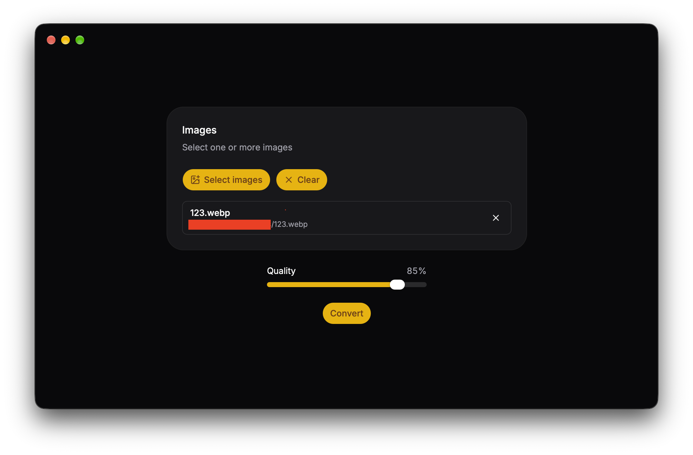

# Image Converter

A simple image converter built with **Go** and **Wails 3**, featuring a frontend powered by **React**, **Tailwind CSS 4**, and **shadcn/ui**.

The idea for this project came from a recurring task at work: converting images from WebP to JPG. Instead of relying on existing tools, I decided to use it as an opportunity to practice Go and build my own converter.

The project initially started as a CLI application, but I later decided to give it a graphical UI as well.

For the first release, I wanted to keep things simple and focused, so the converter supports only WebP-to-JPG conversion. I may expand its functionality and add support for more formats in future releases.

## Screenshots

